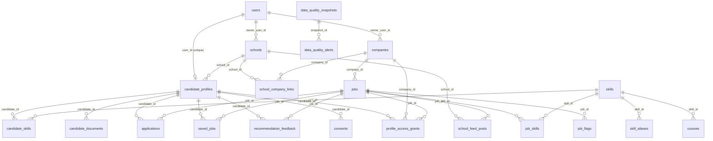

# Báo cáo đồ án CareerBridge

Hệ thống tìm việc thông minh tích hợp AI và BI cho sinh viên và người mới đi làm.

> **Kết luận chính.** Hệ thống hoạt động đầu-cuối với đủ bốn vai trò. Về đánh giá, mô hình gợi ý vượt xa
> ngẫu nhiên (NDCG@5 0,962 so với 0,234), nhưng **chưa chứng minh được hơn baseline chỉ dùng kỹ năng**
> (0,974) trên tập 10 CV. Giá trị đã thấy rõ của mô hình lai là lời giải thích theo từng tiêu chí, không phải
> độ chính xác xếp hạng. Toàn bộ số liệu nghiệp vụ và BI đến từ **dữ liệu mô phỏng**, không phản ánh thị trường thật.

---

## 1. Phân tích yêu cầu và thiết kế cơ sở dữ liệu

### 1.1. Tác nhân

| Vai trò | Mục tiêu | Màn hình chính |
|---|---|---|
| Ứng viên | Biết mình hợp việc nào, thiếu gì, kiểm soát dữ liệu của mình | Hồ sơ & CV, Gợi ý, Thiếu hụt kỹ năng, Hồ sơ đã nộp, Quyền riêng tư |
| Nhà tuyển dụng | Đăng tin, tìm đúng ứng viên, theo dõi hiệu quả tuyển dụng | Tin tuyển dụng, Xếp hạng ứng viên, BI Dashboard |
| Nhà trường | Biết khoảng trống kỹ năng của sinh viên, đẩy tin đối tác | Feed & liên kết, Báo cáo kỹ năng, BI |
| Quản trị viên | Giữ chất lượng dữ liệu và từ điển kỹ năng | Tin cách ly, Chất lượng dữ liệu, Từ điển, BI |

### 1.2. Yêu cầu chức năng

| Mã | Yêu cầu | Thực hiện tại | Kiểm chứng |
|---|---|---|---|
| FR1 | Đăng ký, đăng nhập theo vai trò; xác thực mã số thuế doanh nghiệp | `services/auth_service.py`, `utils/tax_code.py` | Test API, trình duyệt |
| FR2 | Tải CV PDF/DOCX, trích kỹ năng, học vấn, dự án, kinh nghiệm | `ai/cv_parser.py`, `ai/skill_extractor.py` | Unit test, trình duyệt |
| FR3 | Ứng viên xác nhận, sửa, xóa kỹ năng do AI trích | `SkillConfirmCard.jsx` | Trình duyệt |
| FR4 | Gợi ý việc làm kèm điểm và lý do | `ai/matcher.py`, `services/matching_service.py` | Unit test, trình duyệt |
| FR5 | Xếp hạng ứng viên cho từng tin | `rank_candidates` | Test API, trình duyệt |
| FR6 | Báo cáo thiếu hụt kỹ năng, gợi ý khóa học | `skill_gap` | Trình duyệt |
| FR7 | Ứng tuyển và luồng trạng thái hồ sơ | `services/application_service.py` | Test API, trình duyệt |
| FR8 | BI: ứng viên theo kỹ năng, xu hướng lương, tỷ lệ chuyển đổi, cung-cầu | `services/analytics_service.py`, `BiDashboard.jsx` | API, trình duyệt |
| FR9 | Đồng ý theo mục đích; tự thu hồi quyền xem hồ sơ | `services/privacy_service.py` | Test API, trình duyệt |
| FR10 | Phát hiện tin trùng, nghi lừa đảo, thiếu thông tin; vùng cách ly | `ai/quality_checker.py`, `services/quality_service.py` | Unit test, trình duyệt |
| FR11 | Học lại trọng số khớp từ phản hồi | `ai/weight_learner.py` | Unit test, trình duyệt |

### 1.3. Yêu cầu phi chức năng

- **Phân quyền:** JWT và kiểm tra vai trò ở từng endpoint. Nhà tuyển dụng chỉ xem phễu tuyển dụng của doanh nghiệp mình.
- **Quyền riêng tư:** đồng ý tách theo 5 mục đích, có thể rút lại; quyền xem hồ sơ có lịch sử và lý do thu hồi.
- **Khả năng giải thích:** mọi điểm phù hợp đều kèm 6 đặc trưng thành phần và lý do bằng tiếng Việt.
- **Triển khai:** chạy bằng một lệnh Docker Compose (PostgreSQL 16, FastAPI, React qua nginx).

### 1.4. Thiết kế cơ sở dữ liệu

22 bảng, 30 khóa ngoại. Sơ đồ dưới đây được đối chiếu với `information_schema` của PostgreSQL đang chạy.



`matching_weights` đứng độc lập (lưu phiên bản trọng số). `job_flags` có thêm khóa ngoại tới `jobs` (tin bị trùng) và `users` (người xử lý).

**Các quyết định thiết kế**

| Quyết định | Lý do |
|---|---|
| Kỹ năng là thực thể riêng, có bảng từ đồng nghĩa | "ReactJS", "React.js" quy về một kỹ năng, nên so khớp và thống kê BI mới chính xác |
| `job_skills.is_required` | Điểm khớp phân biệt kỹ năng bắt buộc (80%) và ưu tiên (20%) |
| `location_raw` và `location`, `salary_raw` và `salary_min/max` | Giữ nguyên dữ liệu gốc, đồng thời có dạng chuẩn hóa để phân tích |
| `applications.status_history` (JSON) | Tính được phễu cả với hồ sơ đã bị từ chối ở bước sau |
| `recommendation_feedback.features` (JSON) | Lưu đặc trưng tại thời điểm gợi ý, tránh huấn luyện trên dữ liệu đã thay đổi |
| `UNIQUE (job_id, candidate_id)` trên `applications` | Chặn nộp trùng ngay ở tầng CSDL, kể cả khi hai request đồng thời |
| `profile_access_grants` tách khỏi `applications` | Quyền xem có nguồn, thời điểm và lý do thu hồi riêng |

---

## 2. Mô hình AI

### 2.1. Phân tích CV

1. Đọc văn bản từ PDF (`pdfplumber`) hoặc DOCX (`python-docx`).
2. Tách mục (học vấn, kinh nghiệm, dự án...) theo tiêu đề tiếng Việt và tiếng Anh.
3. Trích kỹ năng theo từ điển 68 kỹ năng và các từ đồng nghĩa; so khớp có ranh giới từ, ưu tiên cụm dài (để "React Native" không bị tính thành "React").
4. Ước tính số năm kinh nghiệm: ưu tiên số ghi rõ, nếu không có thì cộng các khoảng thời gian.

Đây là phương pháp dựa trên từ điển, **không phải NER học máy**: dễ giải thích và chính xác trên từ đã biết, nhưng không nhận ra kỹ năng ngoài từ điển.

### 2.2. Điểm tương thích (Matching Score)

Điểm là tổng có trọng số của 6 đặc trưng trong khoảng [0, 1]:

| Đặc trưng | Cách tính | Trọng số mặc định |
|---|---|---|
| Kỹ năng | 80% độ phủ kỹ năng bắt buộc + 20% kỹ năng ưu tiên | 0,45 |
| Nội dung | Cosine TF-IDF (1-2 gram, đã bỏ dấu) giữa CV và mô tả công việc | 0,15 |
| Kinh nghiệm | min(1, số năm có / số năm yêu cầu) | 0,15 |
| Địa điểm | Khớp địa điểm; làm từ xa luôn đạt | 0,10 |
| Vị trí mục tiêu | Độ trùng từ giữa vị trí mục tiêu và tiêu đề tin | 0,10 |
| Hình thức | Khớp hình thức mong muốn | 0,05 |

### 2.3. Học trọng số từ phản hồi

Hồi quy logistic dự đoán "gợi ý có phù hợp không" từ 6 đặc trưng. Hệ số dương được chuẩn hóa thành trọng số mới rồi trộn 50% với trọng số cũ để tránh dao động. Chỉ dùng phản hồi của ứng viên đã đồng ý mục đích "cải thiện mô hình".

---

## 3. BI Dashboard

| Chỉ số | Biểu đồ | Endpoint |
|---|---|---|
| Số lượng ứng viên theo kỹ năng | Cột ngang | `/api/bi/ung-vien-theo-ky-nang` |
| Xu hướng lương (lọc được theo kỹ năng) | Đường | `/api/bi/xu-huong-luong` |
| Tỷ lệ chuyển đổi tuyển dụng | Phễu | `/api/bi/ty-le-chuyen-doi` |
| Nhu cầu kỹ năng, cung-cầu | Cột ngang, cột nhóm | `/api/bi/nhu-cau-ky-nang`, `/api/bi/cung-cau-ky-nang` |
| Lương theo kỹ năng, tin theo địa điểm | Cột ngang | `/api/bi/luong-theo-ky-nang`, `/api/bi/tin-theo-dia-diem` |

Phễu được tính theo **bước xa nhất hồ sơ từng đạt**, nên hồ sơ bị từ chối sau phỏng vấn vẫn được tính vào bước phỏng vấn. Nhà tuyển dụng chỉ thấy số liệu tuyển dụng của doanh nghiệp mình.

Số liệu trên dữ liệu mẫu (toàn hệ thống): 495 hồ sơ ứng tuyển → 391 đã xem (79%) → 143 phỏng vấn (29%) → 54 trúng tuyển (11%).

> **Lưu ý khi đọc số liệu:** mọi con số BI đến từ script seed. Mức lương được cố ý cho tăng khoảng 12% theo năm, tỷ lệ chuyển đổi là xác suất đặt sẵn. Dashboard chứng minh **cơ chế tính và trực quan hóa đúng**, không đưa ra nhận định về thị trường lao động thật.

---

## 4. Tích hợp

```
Trình duyệt ── nginx (:5173) ─┬─ tệp tĩnh React
                              └─ /api/* ── FastAPI (:8000) ── services ─┬─ ai/ (thuần, không phụ thuộc CSDL)
                                                                        └─ PostgreSQL
```

Frontend React 19 + Ant Design + Recharts; 22 màn hình theo vai trò. Toàn bộ endpoint khai báo tập trung trong `frontend/src/config/api.js`; tài liệu API tại `http://localhost:8000/docs`.

---

## 5. Kiểm thử và đánh giá

### 5.1. Kiểm thử hệ thống

| Loại | Phạm vi | Kết quả |
|---|---|---|
| Unit + tích hợp API (`pytest`) | AI, luồng nghiệp vụ, phân quyền | **51/51 đạt** |
| Trình duyệt (Playwright, Chromium) | Đăng nhập cả 4 vai trò, luồng CV → gợi ý → ứng tuyển → từ chối, BI, cách ly, học lại trọng số, giao diện di động | **45/45 bước đạt**, không lỗi JavaScript; 2 phản hồi 403 đều là chặn có chủ đích |
| Lint frontend (ESLint) | Toàn bộ `src` | 0 lỗi, 7 cảnh báo `exhaustive-deps` |
| Lint backend (`ruff`) | Trừ B008 (mẫu `Depends` của FastAPI) và E501 (dòng dài) | Đạt |

**Lỗi tìm thấy trong quá trình kiểm thử trên dữ liệu mẫu và đã sửa:**

| Lỗi | Ảnh hưởng | Vì sao test cũ bỏ sót | Cách sửa |
|---|---|---|---|
| "Khoa học máy tính" bị trích thành Machine Learning; "học sau đại học" thành Deep Learning | Sinh viên CNTT bị gán kỹ năng chưa có, làm sai điểm khớp | Bỏ dấu làm các cụm trùng alias; CV mẫu không chứa cụm này ở dạng đứng riêng | Loại các cụm này trước khi bỏ dấu; thêm test hồi quy |
| Sau khi từ chối ứng viên có bật "cho phép tìm thấy", mở lại hồ sơ kèm `job_id` sẽ tự cấp lại quyền xem | Trái cam kết thu hồi quyền trên giao diện | Ứng viên trong test không bật tìm kiếm | Chặn cấp lại với vị trí đã từ chối; thêm test hồi quy |
| Ô chọn một kỹ năng thực chất chạy ở chế độ chọn nhiều (`mode={undefined}` vẫn nhận giá trị mặc định) | Bộ lọc xu hướng lương và lọc tin theo kỹ năng không có tác dụng; thêm kỹ năng thủ công và alias ở trang cách ly cũng sai | Backend bỏ qua tham số `skill_id[]` mà không báo lỗi, biểu đồ vẫn hiển thị | Bỏ mặc định, trang cần chọn nhiều khai báo rõ; kiểm tra bằng Playwright |
| Baseline được lợi do thứ tự id khi hòa điểm | Đánh giá lệch (xem 5.3) | Lỗi nằm trong chính script đánh giá | Lấy trung bình trên 200 thứ tự xáo trộn |

**Chưa kiểm thử đầu-cuối:** đăng nhập LinkedIn (cần khóa ứng dụng), thu thập tin từ feed đối tác và trang ngoài (chưa cấu hình URL), tải trọng và đồng thời lớn.

### 5.2. Trích xuất kỹ năng từ CV

Tập 10 CV gán nhãn thủ công: **Precision 1,000 · Recall 0,981 · F1 0,990**.

Con số này cần đọc thận trọng: tập nhỏ, CV ngắn, dùng đúng từ vựng trong từ điển, và **chính tập này đã không phát hiện được lỗi "Khoa học máy tính"**. Đó là bằng chứng F1 thực tế sẽ thấp hơn. Trường hợp bỏ sót duy nhất: "GitHub Actions" được quy về CI/CD nên không tính thêm Git.

### 5.3. Hiệu quả mô hình gợi ý

Tập 10 CV, 14 tin, mức phù hợp gán thủ công (trung bình 2 tin phù hợp mỗi CV). Vì vậy P@3 không thể vượt 0,667 và P@5 không thể vượt 0,400.

| Phương pháp | P@1 | P@3 | P@5 | R@5 | NDCG@5 | MRR |
|---|---|---|---|---|---|---|
| Ngẫu nhiên | 0,148 | 0,142 | 0,140 | 0,348 | 0,234 | 0,342 |
| TF-IDF văn bản | 1,000 | 0,533 | 0,340 | 0,883 | 0,947 | 1,000 |
| **Hybrid (đề xuất)** | **1,000** | **0,500** | **0,360** | **0,917** | **0,962** | **1,000** |
| Jaccard kỹ năng | 1,000 | 0,573 | 0,356 | 0,916 | 0,968 | 1,000 |
| Chỉ đặc trưng kỹ năng | 1,000 | 0,571 | 0,371 | 0,941 | 0,974 | 1,000 |

Tái lập: `docker compose run --rm evaluate` (sinh `docs/ket_qua_danh_gia.md`).

**Diễn giải**

1. **So với ngẫu nhiên:** cải thiện rõ ở mọi chỉ số, NDCG@5 gấp khoảng 4 lần.
2. **So với baseline kỹ năng:** Hybrid **không tốt hơn**. Theo từng CV so với Jaccard, Hybrid thắng 1, hòa 6, thua 3; kiểm định dấu cho p ≈ 0,63, nghĩa là không đủ bằng chứng về khác biệt theo bất kỳ hướng nào.
3. **Nguyên nhân có thể:** tập đánh giá quá dễ. Mỗi tin thuộc một ngành rõ ràng nên chỉ riêng kỹ năng đã xếp đúng hạng 1 cho mọi CV. Các đặc trưng địa điểm và hình thức có thể đẩy tin khác ngành lên cao hơn tin phù hợp một phần (CV5: hạng 3 của Hybrid là tin DevOps cùng thành phố).
4. **Trọng số học được:** khi thử trọng số học từ phản hồi, NDCG@5 đạt 0,960, không cải thiện so với mặc định. AUC kiểm định chéo 0,89 của mô hình học trọng số đo trên phản hồi **mô phỏng** nên không nói lên chất lượng với người dùng thật.

**Điều chỉnh trong đánh giá.** Phiên bản đầu của script dùng sắp xếp ổn định: khi hòa điểm, tin có id nhỏ đứng trước. Tin số 1 lại thường được gán nhãn phù hợp, nên baseline được lợi ngẫu nhiên (Jaccard NDCG@5 0,986 giảm còn 0,968 sau khi sửa). Hybrid gần như không có hòa điểm nên giữ nguyên 0,962. Việc sửa thu hẹp khoảng cách nhưng **không đảo ngược kết luận**; trọng số không được chỉnh theo tập đánh giá.

### 5.4. Hạn chế và hướng phát triển

| Hạn chế | Hướng xử lý |
|---|---|
| Tập đánh giá nhỏ, dễ, do nhóm tự gán nhãn | Mở rộng lên hàng trăm cặp CV-tin, có tin cùng ngành khó phân biệt, nhiều người gán nhãn độc lập |
| Chưa có dữ liệu người dùng thật | Thử nghiệm với sinh viên, đo tỷ lệ bấm và ứng tuyển theo hạng |
| Trọng số mới có hiệu lực ngay, không qua kiểm tra | Chỉ kích hoạt khi NDCG trên tập kiểm định không giảm |
| Trích xuất theo từ điển, alias đa nghĩa ("spring", "node", "container") | Dùng ngữ cảnh hoặc NER; xem xét từng alias |
| PDF scan không có lớp chữ không đọc được | Thêm OCR |
| Thiếu đặc trưng cấp bậc: ứng viên 1 năm kinh nghiệm vẫn được gợi ý tin Senior ở hạng 2 | Đưa cấp bậc thành đặc trưng hoặc bộ lọc |
| Khi từ chối, quyền xem chỉ thu hồi theo vị trí; doanh nghiệp vẫn có thể xem qua tin đang mở khác nếu ứng viên bật tìm kiếm | Cần quyết định nghiệp vụ: chặn theo vị trí hay toàn doanh nghiệp |
| Tạo bảng bằng `create_all`, chưa có migration | Dùng Alembic trước khi triển khai thật |
| `JWT_SECRET` mặc định trong compose chỉ dùng demo | Đặt biến môi trường khi triển khai |
